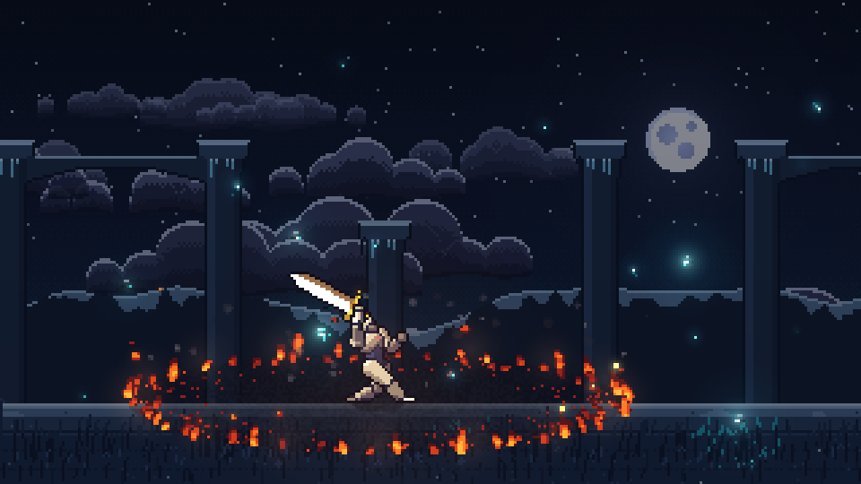
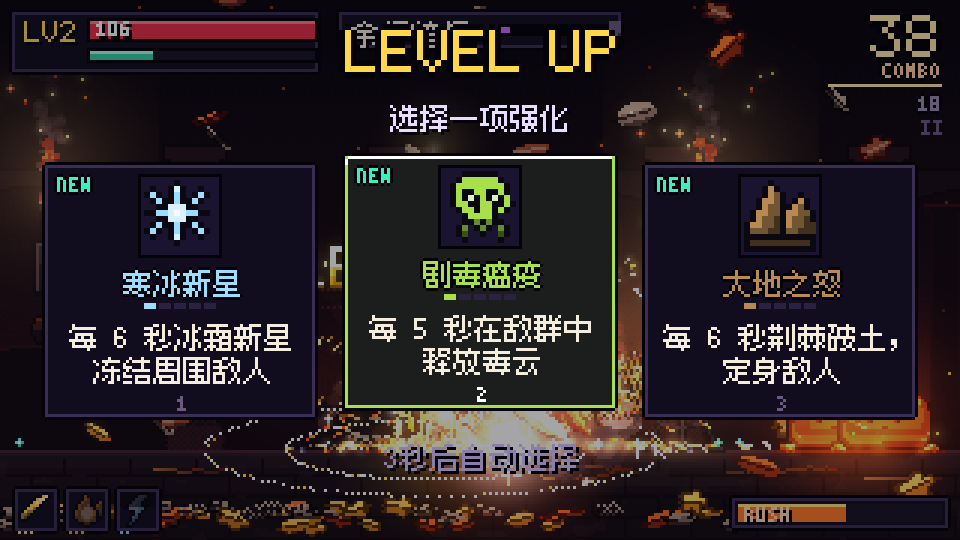
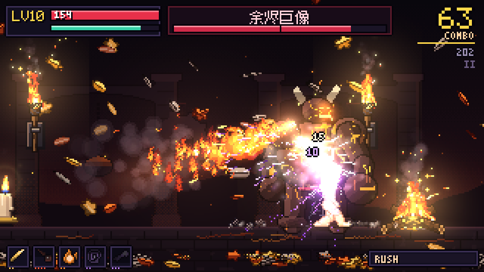
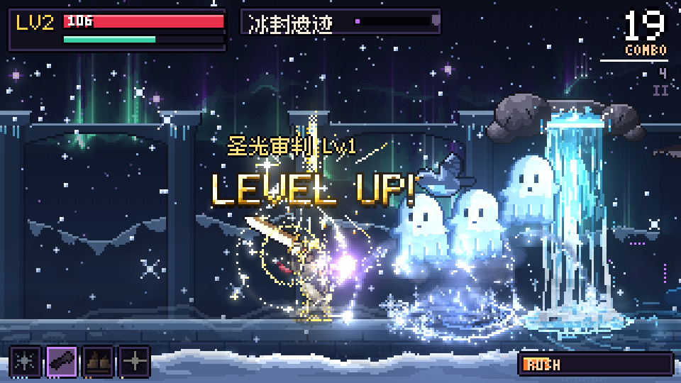
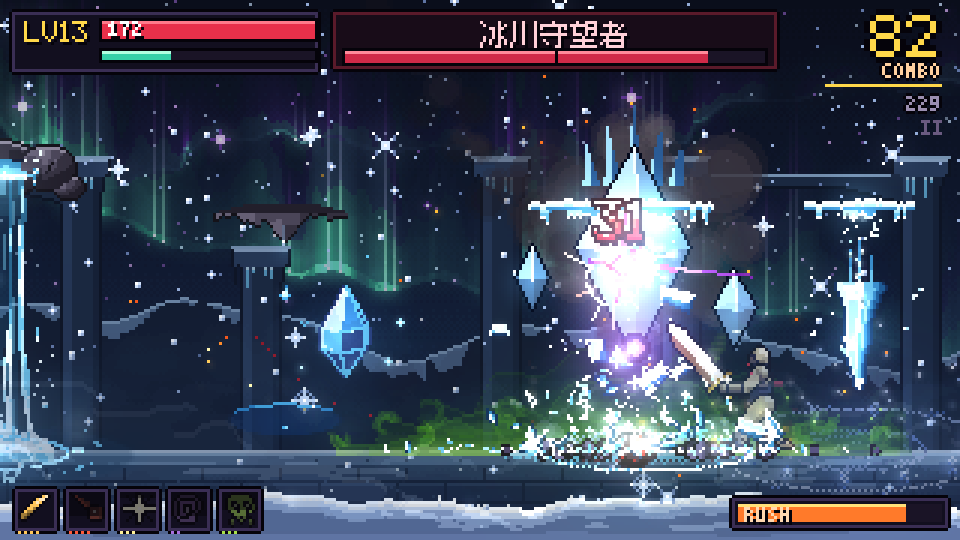
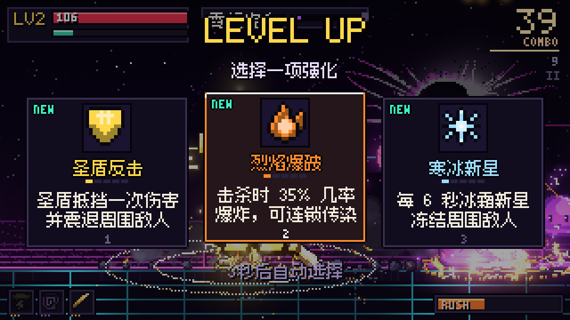
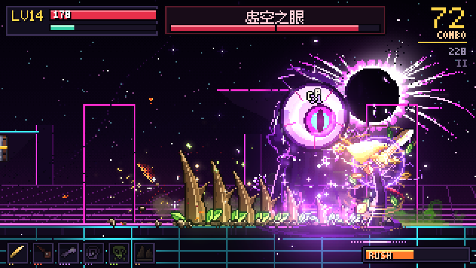
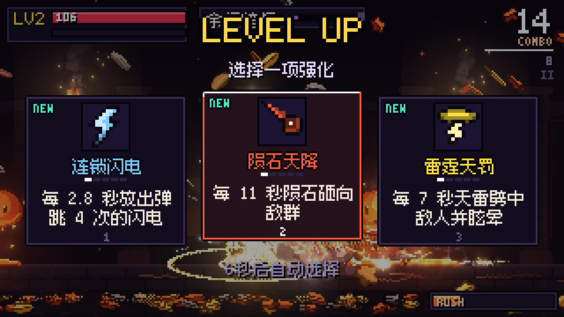
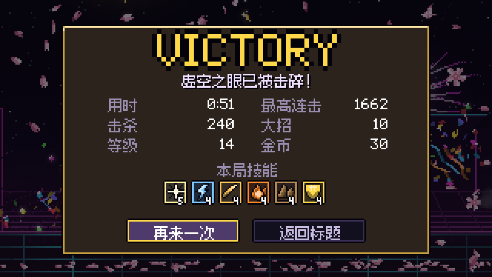

<h1 align="center">⚔️ FX RUSH</h1>

<p align="center">
  <strong>Every swing a spectacle. Every kill a firework. Seven minutes of pure pixel carnage.</strong>
</p>

<p align="center">
  A short, explosive side-view pixel auto-battler that runs in your browser.<br>
  The hero fights on his own (or switch to manual and fight yourself); you pick a power at every level-up,<br>
  and watch the screen turn into a symphony of 242 hand-crafted PixelFX effects.
</p>

<p align="center">
  <a href="https://seiya058904.github.io/FX-Rush/"><strong>▶ Play in Your Browser</strong></a>
  &nbsp;·&nbsp;
  <a href="#the-rush">🎮 The Rush</a>
  &nbsp;·&nbsp;
  <a href="#gameplay">📷 Gameplay</a>
  &nbsp;·&nbsp;
  <a href="#how-to-play">⌨️ Controls</a>
  &nbsp;·&nbsp;
  <a href="#run-locally">⚙️ Run Locally</a>
</p>

<p align="center">
  <sub>THREE SCENES &nbsp;·&nbsp; THREE BOSSES &nbsp;·&nbsp; 12 AUTO-CAST SKILLS &nbsp;·&nbsp; 242 / 244 PIXELFX EFFECTS IN PLAY &nbsp;·&nbsp; 100% OFFLINE</sub>
</p>

<p align="center">
  
  
  
  
</p>

<p align="center">
  <a href="https://seiya058904.github.io/FX-Rush/">
    
  </a>
  <br />
  <sub>REAL IN-GAME CAPTURES · NATIVE 320×180, SCALED 3×</sub>
</p>

---

> **Three seconds after you click, the first slime is already flying.**
>
> A knight in ivory armour and a crimson scarf walks into three hostile worlds. He finds the nearest monster and fights in combos — opener, link, finisher — conjuring a different weapon for each of PixelFX's twelve melee acts (sword, claws, daggers, whip, spear, fist, hammer, scythe), dealt from shuffle bags so they keep changing, while every skill you pick fires by itself in rotation. Prefer to fight yourself? Switch to manual: walk, jump and click toward the side you want to cut. Fill the **RUSH** meter and he performs a whole PixelFX move: a meteor call, a rocket launcher, a dash through the crowd.

<a id="the-rush"></a>
## 🎮 The Rush

<table>
  <tr>
    <td width="33%" valign="top">
      <h3>🔥 01 · Ember Forge</h3>
      <p><sub>余烬熔炉 · SLIMES · SKULLS · KNIGHTS</sub></p>
      <p>Lava slimes, flaming skulls that dive and spit fireballs, ash knights and claw ghouls. Explosive barrels, forge cannons and a meteor shower — then the <strong>Cinder Colossus</strong> breaks out of the floor.</p>
    </td>
    <td width="33%" valign="top">
      <h3>❄️ 02 · Frozen Ruins</h3>
      <p><sub>冰封遗迹 · GHOSTS · LANCERS · ARCHERS</sub></p>
      <p>Aurora over a frozen colonnade. Ghosts, frost crows, ice wisps, spearmen, archers and whip witches; geysers, a healing fountain and a tornado — and the floating <strong>Glacier Warden</strong>.</p>
    </td>
    <td width="33%" valign="top">
      <h3>🌌 03 · Neon Void</h3>
      <p><sub>霓虹虚空 · EYES · REAPERS · GUNNERS</sub></p>
      <p>A black sun over a synthwave grid. Laser eyes, plasma jellyfish, scythe reapers, smoke-bombing gunners and jet troopers — and the final <strong>Void Oculus</strong>, who goes out in a nuclear bloom.</p>
    </td>
  </tr>
</table>

**Grow fast, grow loud.** Kills drop experience; every level offers three cards. Twelve skills — **Blade Waves, Chain Lightning, Inferno, Frost Nova, Arcane Barrage, Black Hole, Aegis, Meteor, Thunder, Holy Smite, Earth Fury, Plague** — each gain five levels, and every level changes what you see. They feed each other: frozen monsters shatter under fire, poison spreads on death, kill explosions chain into more kills. A 150-hit combo stops time.

**Feel every hit.** Each blow is a PixelFX *act*: a real wind-up, the contact frame, a freeze tuned by weight (budgeted so a crowd never stalls the game), knockback, squash, a flash, a small damage number (merged per enemy so a flurry stays readable) and its sound on the same frame. Normal hits, crits, area blasts and boss finishers each read differently; the run's best hit gets PixelFX's crit starburst on the results screen.

**Readable chaos.** Bosses and elites telegraph with a red rune, a raised fist, a scanner lock or an opening pool — and the hero's AI reads those tells too, stepping out of marked zones and jumping shock waves, so you can play fully idle.

<a id="gameplay"></a>
## 📷 Gameplay

<table>
  <tr>
    <td width="50%" align="center"><br /><sub><strong>Ember Forge</strong> · braziers, ash and kill explosions</sub></td>
    <td width="50%" align="center"><br /><sub><strong>Cinder Colossus</strong> · slams, fire breath, meteors</sub></td>
  </tr>
  <tr>
    <td align="center"><br /><sub><strong>Frozen Ruins</strong> · frost nova, ice spikes, snow</sub></td>
    <td align="center"><br /><sub><strong>Glacier Warden</strong> · icicles, tidal wave, blizzard</sub></td>
  </tr>
  <tr>
    <td align="center"><br /><sub><strong>Neon Void</strong> · thunder, black holes, gunners</sub></td>
    <td align="center"><br /><sub><strong>Void Oculus</strong> · beams, grasping hands, star fall</sub></td>
  </tr>
  <tr>
    <td align="center"><br /><sub><strong>Level up</strong> · three cards, the fight stays visible</sub></td>
    <td align="center"><br /><sub><strong>Victory</strong> · confetti, fireworks, your build</sub></td>
  </tr>
</table>

<a id="how-to-play"></a>
## ⌨️ How to Play

| Action | Mouse / keyboard | Touch |
|---|---|---|
| Switch mode: **auto** (default — the hero fights by himself, you watch and pick cards) / **manual** | **Tab** · title strip · pause menu | title strip · pause menu |
| Manual: attack toward the clicked side (combos and weapons rotate as in auto) | **click** left / right of the hero | **tap** |
| Manual: move | **A / D** · **← / →** | — |
| Manual: jump | **Space** · **W** · **↑** | swipe up |
| Skills, RUSH ultimates | automatic in both modes | automatic |
| Pick a level-up card | **1 / 2 / 3** · click · **←/→ + Enter** (auto-picks after 6 s) | tap |
| Pause & settings (shake, flashes, auto-pick, quality, volume) | **Esc** · **P** | **II** top-right |
| Mute | **M** | pause menu |

A run is three scenes and three bosses, about **7 minutes**. One second wind per run; the boss key ends each scene.

<a id="run-locally"></a>
## ⚙️ Run Locally

```bash
npm install
npm run dev        # http://localhost:5173 — the game;  /fxlab.html — the FX Lab
npm run build      # static site in dist/, deployable to any static host
```

Requires Node 20.19+ or 22.12+ (tested on Node 24). No backend, accounts or network services: the build runs fully offline.

## 🧪 PixelFX, All of It

FX Rush is built on [**PixelFX**](https://github.com/patch-gg/pixelfx) (MIT) — 244 pixel-art effects written as code. The library is vendored unmodified at a pinned commit under `third_party/pixelfx/` ([UPSTREAM.md](third_party/pixelfx/UPSTREAM.md)) and loaded lazily, one chunk per category.

| Measure (`npm run audit`) | Count |
|---|---|
| Effects in the upstream index / vendored files | **244 / 244** |
| Load and pass the headless self-test (draws, stays in bounds, ends or stops) | **244 / 244** |
| Wired into game code | **242 / 244** |
| Seen on screen in recorded play sessions | **242 / 244** |

Two effects are deliberately kept out of play because their big full-canvas bursts covered the fight: `ui/crit-number` (the CRIT starburst) and `explosions/cartoon-pow` (POW!/WOW!). Both still load, pass the self-test and can be previewed in the FX Lab.

Every effect has a job — monster bodies (critters), the hero's and enemies' attacks (melee acts and moves), skills, statuses wrapped round each monster's real silhouette, deaths, loot, UI, scenery, weather, sky, screen transitions. The full table with each effect's role is in [docs/COVERAGE.md](docs/COVERAGE.md). The **FX Lab** (`/fxlab.html`) previews any effect with its act and re-runs the self-test in the browser through the same loader the game uses.

<details>
<summary><strong>🛠️ Under the Hood</strong></summary>

- **Rendering:** PixelFX's two-buffer frame (color + additive light) at 320×180, composited over a parallax background so every glow lights the scene; integer scaling with nearest-neighbour filtering.
- **Characters:** the hero and every knight are PixelFX's 3D skeleton rig with custom skins; monsters are PixelFX critters baked lazily into sprite frames (hit flash, tints, squash). Bosses are original procedural pixel art drawn with the PixelFX painter.
- **Effect director:** priorities and budgets per quality level, per-category trimming of long tails, baked scenery loops, throttled full-screen weather, measured visual centres for placement, runtime coverage tracking.
- **Feel:** fixed 60 Hz logic, hit-stop budget, slow motion for big moments, capped and reducible screen shake, recorded sound effects with level-matched variants, plus chiptune cues and music per scene and boss synthesized with Web Audio (which also stands in for any sample that has not loaded).
- **Performance:** automatic quality (drops non-essential detail first, never the contact frame). Measured on Windows Chrome 156, Ryzen 7 9700X / RX 7900 XT, 1280×720 window: typically 4–9 ms of CPU per frame at full detail, comfortably above 60 FPS; with 4× CPU throttling the game falls back to its lowest quality level.

```text
src/engine/     PixelFX adapter, input, audio (samples and Web Audio synth), pixel text, screen
src/fx/         effect director, palettes, generated registry, roles, custom effect
src/game/       hero, monsters, bosses, skills, combat, statuses, stages, loot
src/render/     scenes, HUD, cards, screens, icons
src/dev/        FX Lab
tools/          registry generator, effect self-test, coverage audit, e2e play tests, sound pipeline
third_party/    PixelFX, vendored at a pinned commit
```

</details>

### Verification, Without Guesswork

- `npm run smoke` — all 244 effects headless: **244 pass, 0 warn, 0 fail** (same bounds rule as upstream `tools/check.mjs`).
- `npm run e2e` (needs a running dev server and local Chrome) — a full idle run with real damage that clears all three bosses, six god-mode build sessions that drive every skill to level 5 across all scenes, a rare-branch session, manual controls (click, move, jump, pause, focus loss, four window sizes, restart, back to title, death and retry) and a touch-phone session. Screenshots are kept in `docs/screenshots/`.
- CI (`.github/workflows/pages.yml`) checks the registry against the vendored tree, runs the self-test and audit, builds, and deploys to GitHub Pages; Markdown/docs-only changes skip it.

## 🎨 Credits & License

- Effects, runtime and character rig: **[PixelFX](https://github.com/patch-gg/pixelfx)** by Patch, with parts adapted from Hugo Duprez's Sprite Fusion VFX and Hollow Crown — MIT ([LICENSE](third_party/pixelfx/LICENSE), [NOTICE](third_party/pixelfx/NOTICE.md)). The non-MIT Patch Pixel gallery font is **not** included.
- Chinese UI font: **[Fusion Pixel Font](https://github.com/TakWolf/fusion-pixel-font)** 10px — SIL Open Font License 1.1, bundled unmodified with its component licenses in `public/fonts/fusion-pixel/`.
- Sound effects: from **[Freesound](https://freesound.org)**, modified for the game, under CC0 or CC BY. Every file, author and license is listed in [public/audio/CREDITS.md](public/audio/CREDITS.md).
- Bosses, scenes, HUD, icons, synthesized sounds and music: original to FX Rush.

The original FX Rush code, art, synthesized sound and branding are © seiya058904, all rights reserved — see [LICENSE](LICENSE). Third-party components keep their own licenses.

---

<p align="center">
  <strong>Click once. Then let it rain.</strong><br />
  <sub>FX Rush · built on PixelFX</sub>
</p>
